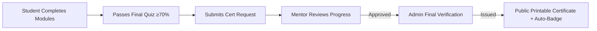
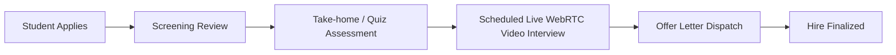

# 🌉 SkillBridge Ethiopia — EdTech & Talent Acceleration Platform

[](https://github.com/your-username/Mentorship_platform/actions)


A full-stack, enterprise-grade EdTech and Talent Pipeline ecosystem connecting higher-education learners with verified industry mentors and hiring employers across emerging tech markets.

---

## ⚡ 1-Click Demo Login (Instant Reviewer Access)

For portfolio reviewers, recruiters, and hiring managers: No manual registration or password entry is required. On both the `/login` and `/register` pages, click any of the **Quick Demo Access** buttons:

| Demo Role | Focus Features | Quick Access |
|---|---|---|
| **🎓 Student** | Course learning, interactive quizzes, verifiable certificates, job applications | 1-Click Button on `/login` & `/register` |
| **👨‍🏫 Mentor** | Curriculum builder, review student requests, schedule 1-on-1 video sessions | 1-Click Button on `/login` & `/register` |
| **🏢 Employer** | Search certified student directory, post jobs, manage multi-stage ATS | 1-Click Button on `/login` & `/register` |
| **🛡️ Admin** | User governance, approval queues, course moderation, audit reports | 1-Click Button on `/login` & `/register` |

---

## 🏗️ Architecture & Core Workflows

### 1. Dual-Stage Certificate Verification Engine


### 2. Employer ATS (Applicant Tracking System) & WebRTC Interviews


### 3. Real-Time WebSockets Engine (Socket.io)
- **Instant Messaging**: Real-time bidirectional chat with typing indicators between Students, Mentors, and Employers.
- **Live Notifications**: Instant push alerts for interview schedules, certificate approvals, and application status changes.

---

## 🛠️ Tech Stack

- **Frontend**: React 19, Vite 8, Tailwind CSS v4, React Router 7, `@jitsi/react-sdk` (WebRTC), `socket.io-client`, Lucide React, Axios.
- **Backend**: Node.js 20, Express 4, MongoDB & Mongoose 8, `socket.io`, JWT authentication, Bcrypt, Multer, Nodemailer.
- **DevOps & QA**: Docker, Docker Compose, Nginx, Vitest, React Testing Library, Supertest, Jest, GitHub Actions CI.

---

## 🚀 Getting Started

### Local Development

1. **Clone the repository**:
   ```bash
   git clone https://github.com/your-username/Mentorship_platform.git
   cd Mentorship_platform
   ```

2. **Install all dependencies**:
   ```bash
   npm run install:all
   ```

3. **Configure Environment Variables**:
   ```bash
   cp server/.env.example server/.env
   cp client/.env.example client/.env
   ```

4. **Start Development Servers**:
   ```bash
   # Terminal 1: Backend API (http://localhost:5000)
   npm run dev:server

   # Terminal 2: Frontend Client (http://localhost:5173)
   npm run dev:client
   ```

---

## 🐳 Docker Containerization

Run the entire platform (MongoDB + Backend + Nginx Frontend) with one command:
```bash
docker-compose up --build
```
- Frontend: `http://localhost`
- Backend API: `http://localhost:5000/api`
- MongoDB: `mongodb://localhost:27017/skillbridge`

---

## 🧪 Testing & Code Quality

```bash
# Run client linter (0 errors, 0 warnings)
npm run lint

# Run frontend unit & component tests (Vitest)
npm run test:client

# Run backend integration tests (Jest + Supertest)
npm run test:server

# Run entire test suite
npm test
```

---

## 🌐 Production Deployment Guide

### Deploying Frontend to Vercel
1. Import repository into [Vercel](https://vercel.com).
2. Set Root Directory to `client`.
3. Add Environment Variable:
   - `VITE_API_URL`: `https://your-render-backend.onrender.com/api`
4. Deploy! `client/vercel.json` ensures all SPA routes redirect cleanly.

### Deploying Backend to Render
1. Create a new **Web Service** on [Render](https://render.com).
2. Set Root Directory to `server`.
3. Build Command: `npm install`
4. Start Command: `npm start`
5. Add Environment Variables:
   - `NODE_ENV`: `production`
   - `MONGO_URI`: `mongodb+srv://<user>:<pass>@cluster.mongodb.net/skillbridge`
   - `JWT_SECRET`: `<your-secure-random-jwt-key>`
   - `CLIENT_URL`: `https://your-vercel-app.vercel.app`
